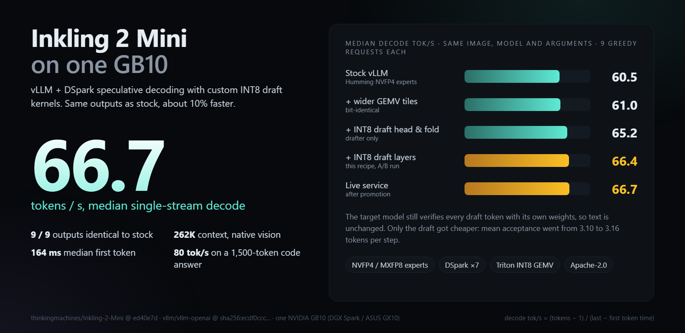

# Inkling 2 Mini on a single DGX Spark

This recipe serves [Inkling 2 Mini](https://huggingface.co/thinkingmachines/Inkling-2-Mini) on a single NVIDIA GB10 (DGX Spark, ASUS GX10) with vLLM. It drafts with [Inco AI's DFlash 2 drafter](https://huggingface.co/incoai/Inkling-2-Mini-DFlash2) instead of the model's bundled DSpark head, and gives the drafter compact draft-only weights. The target model's weights are untouched. You get an OpenAI-compatible endpoint with a 262K-token context, image input, reasoning and tool calls.

- **83.3 tok/s** median single-stream decode, up from **66.7** with this repository's previous DSpark q8 profile (+25%) and **60.5** with stock vLLM.
- **Same text:** all 9 benchmark outputs are byte-identical to stock vLLM. The drafter only proposes tokens; the target model still verifies every one.
- **8 requests at once:** 177.7 tok/s aggregate, against 171.1 with the q8 profile.
- **262,144-token context:** a 210,386-token needle prompt was answered correctly, decoding at 39.0 tok/s, with no swap.
- **Native vision:** the 2- and 8-image color checks pass.

## Quick start

You need one GB10 with Docker and the NVIDIA container runtime, about 50 GB of free disk and about 80 GB of free unified memory. The server takes 65% of the GPU memory.

```bash
git clone https://github.com/sxuff/inkling-2-mini-spark
cd inkling-2-mini-spark
python3 scripts/download.py            # pinned checkpoint (20.2 GB) into ~/models, every file verified
python3 scripts/download.py --dflash2  # pinned DFlash 2 drafter (0.99 GB)
./scripts/serve.sh                     # dflash2 profile on 127.0.0.1:8020
```

The image is about 27 GB, and `serve.sh` pulls it on first use. With the image already pulled and an empty cache, the first start took 149 s on the test machine. Later starts reuse `~/.cache/inkling2-mini-vllm` and took 42 s.

```bash
curl -s http://127.0.0.1:8020/v1/chat/completions -H "Content-Type: application/json" -d '{
  "model": "thinkingmachines/Inkling-2-Mini",
  "messages": [{"role": "user", "content": "What is 17 times 24?"}],
  "reasoning_effort": "low"
}'
```

- **Reasoning** comes back in a separate `reasoning_content` field. `reasoning_effort` sets how much the model thinks.
- **Tool calls** use vLLM's `inkling` tool parser, which `serve.sh` already enables.
- **Images** go in as normal OpenAI `image_url` parts. Video input is off.
- **Profiles:** `serve.sh dflash2` is the default. `serve.sh q8` is the previous DSpark recipe (described [below](#the-dspark-q8-profile)), `serve.sh humming` is DSpark without any recipe kernels, and `serve.sh stock` also drops the Humming expert backend. Use them for A/B runs.
- **Overrides:** `serve.sh` takes `MODEL_DIR`, `DRAFT_DIR`, `PORT`, `GPU_UTIL`, `MAX_LEN`, `MAX_SEQS`, `CACHE_DIR` and `CONTAINER` from the environment, and for `dflash2` also `DFLASH2_HEAD_QUANT` and `DFLASH2_BODY_QUANT` (`off`, `int8`, `int4_g64`, `int4_g128`, `nvfp4`, `hybrid`).

## Results

Single-stream numbers use `scripts/bench.py`: 3 prompts (code, prose, math) × 3 repeats, greedy, exactly 160 generated tokens with reasoning included. Decode tok/s = (tokens − 1) / (last − first streamed token). Prefill and concurrency use `tools/bench_full.py`. The q8 column is the live q8 service measured the same day on the same machine.

| | DSpark q8 (`serve.sh q8`) | **DFlash 2 (`serve.sh dflash2`)** |
|---|---:|---:|
| Median decode | 66.69 tok/s | **83.34 tok/s** (+25.0%) |
| Code / prose / math | 73.36 / 45.57 / 66.69 | **83.34 / 60.38 / 83.92** |
| Tokens per step (1 + accepted drafts) | 3.16 | **3.83** |
| Median first token | 179 ms | 166 ms |
| Outputs equal to stock vLLM | 6/6 | **9/9** |
| Cold prefill, 10.0K / 18.8K / 72.8K tokens | 3,818 / 3,817 / 3,133 tok/s | 3,836 / 3,800 / 3,212 tok/s |
| 4 concurrent requests, 384 tokens each | **120.1 tok/s** | 113.1 tok/s (−5.9%) |
| 8 concurrent requests, 384 tokens each | 171.1 tok/s | **177.7 tok/s** (+3.9%) |
| GPU memory share | 0.61 | 0.65 |

- **Clean-copy check:** `download.py` verification of the checkpoint, a fresh `download.py --dflash2` from Hugging Face (byte-identical to the benchmarked drafter), then `serve.sh` from a copy of this repository with an empty cache: 83.61 tok/s median, all 9 hashes equal to stock, both vision checks passed. A warm restart gave 83.56 tok/s and 9/9. On a second pass, prefill ran at 3,872 / 3,830 / 3,207 tok/s, 4 requests at 117.3 tok/s and 8 at 183.2 (`results/dflash2/clean-copy/`).
- **Long context:** a 210,386-token prompt with one hidden code line was answered correctly. Prefill ran at 2,208 tok/s (95 s to first token), decode at 39.0 tok/s, with 35 GiB of memory still free and no swap (`results/dflash2/needle-210k.json`).
- **Sampling:** one 1,024-token code request each decoded at 62.9 tok/s at T=0, 79.5 at T=0.7 and 71.8 at T=1.0, and a 512-token prose request at 45.7 tok/s at T=0.7 (`results/dflash2/sampled.json`). These are single requests, so they swing with how predictable each answer is.
- **Real time:** a 1,024-token code answer decoded at 84.8 tok/s with the first token at 164 ms, and 8 different requests at once ran at 190 tok/s while all 8 were decoding (4,077 tokens in 25.3 s end to end). These are per-token stream timestamps recorded with `tools/realtime_capture.py` (`results/dflash2/realtime/`).

### How the drafter was tuned

Each arm is the same server with different draft-weight formats, 6 requests (3 prompts × 2), compared hash for hash with stock vLLM. The full receipts are in `results/dflash2/ladder/`.

| Draft LM head | Draft body | Median | Code | Prose | Math | Tokens per step | C=8 | = stock |
|---|---|---:|---:|---:|---:|---:|---:|---:|
| BF16 | BF16 | 78.96 | 79.4 | 54.7 | 79.0 | 3.90 | 160.4 | 6/6 |
| INT8 | INT8 | 82.79 | 85.0 | 58.6 | 82.8 | 3.87 | 177.1 | 6/6 |
| INT4, groups of 64 | INT8 | 83.27 | 85.7 | 55.6 | 83.3 | 3.78 | 177.0 | 6/6 |
| **INT4, groups of 128** | **INT8** | **83.42** | 83.4 | **60.4** | 83.9 | 3.83 | 184.3 | 6/6 |
| INT4, groups of 64 | INT4, groups of 64 | 79.10 | 81.3 | 58.8 | 79.1 | 3.75 | 189.2 | 6/6 |
| NVFP4 | INT8 | 81.79 | 81.8 | 59.4 | 84.2 | 3.81 | 175.9 | 6/6 |
| NVFP4 | NVFP4 | 78.27 | 78.3 | 61.2 | 87.1 | 3.81 | 171.2 | 6/6 |
| NVFP4 | NVFP4 MLP, INT8 attention | 79.86 | 79.9 | 62.2 | 84.6 | 3.84 | 173.0 | 6/6 |

- **The default** is INT4 (groups of 128) for the head and INT8 for the body, plus the fused convolution kernel and the GEMV tile table described below. With 9 requests it measured 83.34 tok/s, 9/9 equal to stock.
- **The head goes to 4 bits, the body doesn't:** the 201,024-row LM head the drafter reads every step is most of its weight traffic, so halving it again pays off. A 4-bit body costs more in accepted tokens than it saves in bytes.
- **Rejected, because outputs changed:** drafting 5 or 6 tokens instead of 7 was slower (58.7 and 57.1 tok/s) and changed all 6 outputs. A wider target-side GEMV tile for verification batches reached 93.7 tok/s on code but also changed all 6 outputs. Neither is in this repository.

## How DFlash 2 works here

DFlash 2 drafts a block of 7 tokens in a single pass of a small block-diffusion model, keeps the top candidates at each position, and a selector picks one path through them. The pinned vLLM image already runs it (`--speculative-config '{"method":"dflash", ...}'`). On a GB10 every decode step is limited by memory bandwidth, so this recipe makes the drafter read fewer bytes per step.

Five vLLM modules are mounted read-only over the pinned image (`overlay/dflash2/`, also as `patches/inkling2-gb10-dflash2.patch`). `serve.sh` checks each file's SHA-256 before launch, and also mounts `gemv_q8.py` from the q8 profile.

1. **`model_executor/models/qwen3_dflash2.py`:** at load time, makes draft-only copies of the drafter's weights. `DFLASH2_HEAD_QUANT` picks the format of the LM head copy the drafter uses (default INT4 with a scale and zero point per group of 128). `DFLASH2_BODY_QUANT` picks the format of its projections, attention, MLP and context K/V (default INT8 with one scale per row). Decode-sized batches (up to 64 rows) use the copies; prefill keeps BF16. `DFLASH2_FUSED_OPS=1` fuses each block's convolution, residual add and RMSNorm into one kernel from the image. The file also applies the draft config's `selector_softcap_mode` and the target's embedding norm to the drafter's inputs.
2. **`models/inkling2/nvidia/ops/gemv_q4.py` (new):** Triton GEMVs for the INT4 and INT8 copies, registered as custom ops so they run inside vLLM's CUDA graphs.
3. **`v1/worker/gpu/spec_decode/dflash/speculator.py`:** during a long prefill, computes and stores the drafter's context K/V only for positions still inside its sliding window (`DFLASH2_SKIP_EXPIRED_CTX=1`).
4. **`v1/worker/gpu/spec_decode/dflash/utils.py`:** shares the target's embedding norm with the drafter and builds the quantized copies after the weights load.
5. **`models/inkling2/nvidia/ops/gemv.py`:** picks the BF16 GEMV tile by output width (32×512 for the LM head, 16×512 for N ≥ 4096, 16×256 for N ≤ 1024). Each output column keeps the same K-ordered tensor-core chain, so results are bit-identical.

**Why the text doesn't change:** the target model accepts or rejects every draft token with its own BF16/NVFP4/MXFP8 weights. With greedy decoding, the output is the target's argmax whatever the drafter proposes. With sampling, vLLM keeps the probabilities each draft token was sampled from, here from the compact copies, and rejection sampling against them stays exact. A cheaper drafter can only change how many tokens each step accepts.

## Configuration

| Component | Pin |
|---|---|
| Model | `thinkingmachines/Inkling-2-Mini` @ `ed40e7da625f594fc9c4990f5f66be24873c22d7`: native NVFP4 experts (layers 0–19), MXFP8 experts (20–23), BF16 everything else, bundled DSpark draft |
| Drafter | `incoai/Inkling-2-Mini-DFlash2` @ `4f9088ea66c21f2b99ed657d1941c306b03e84d2` (`model.safetensors`, SHA-256 `217980ab…`) |
| Runtime | `vllm/vllm-openai` @ `sha256:ecdf0ccc663d86332459f5a50a38c30861a5079bc3924aa08fdc657ef10dd648` (ARM64; vLLM 0.1.dev25855+g7cb5dae22, PyTorch 2.14, Triton 3.8) |
| Speculation (`dflash2`) | `dflash`, 7 tokens, probabilistic draft sampling, BF16 draft KV cache |
| Serving (`dflash2`) | `--moe-backend humming --safetensors-load-strategy eager --max-model-len 262144 --max-num-seqs 8 --max-num-batched-tokens 4096 --gpu-memory-utilization 0.65` |
| Recipe env (`dflash2`) | `DFLASH2_HEAD_QUANT=int4_g128`, `DFLASH2_BODY_QUANT=int8`, `DFLASH2_SKIP_EXPIRED_CTX=1`, `DFLASH2_FUSED_OPS=1` |
| `q8` profile | `dspark`, 7 tokens, `--gpu-memory-utilization 0.61`, `INKLING2_DRAFT_QUANT=int8`, `INKLING2_DRAFT_QUANT_LAYERS=1` |

## Reproduce

With the server running:

```bash
python3 scripts/bench.py my-run.json --compare results/ab/stock.json         # decode, parity, vision
python3 tools/bench_full.py --out my-full.json --skip-short --skip-vision    # prefill ladder, 4 and 8 concurrent
python3 tools/sampled_and_needle.py --out my-long.json --with-needle         # sampled runs, ~200K needle
python3 tools/realtime_capture.py --mode multi --out my-capture.json         # per-token timestamps, 8 requests
```

`bench.py` prints the median and per-prompt tok/s, tokens per step, and how many outputs match the stock run hash for hash. It also runs the 2- and 8-image vision check. For an A/B, start `serve.sh q8` and `serve.sh dflash2` in turn and run the bench against each. To try another draft-weight format, set `DFLASH2_HEAD_QUANT` or `DFLASH2_BODY_QUANT` before `serve.sh`.

## Limits

- **4 concurrent requests are slower** than with the q8 profile (113.1–117.3 against 120.1 tok/s). 8 requests are faster.
- **First request at a new batch size:** after each start, the first request at each new concurrency level compiles kernels, so its first token took 1.5–2.9 s instead of about 0.35 s, and that pass ran at 103–107 tok/s with 4 requests and 155–181 with 8. Send one short request at the concurrency you expect after startup. The concurrency numbers above were measured after such a pass.
- **Keep 7 draft tokens:** with 5 or 6, the outputs no longer matched stock vLLM in this test, and decode was slower.
- **What was tested:** single-stream greedy text, the vision check, a 210K-token needle, 4 and 8 concurrent requests, and a few single sampled requests. Sampled speed was not compared against the q8 profile.
- **Memory:** the profile uses 65% of the GPU memory instead of 61%, for the drafter, its BF16 K/V cache and the compact copies.
- **What's left is lossy:** as with the q8 profile, the target's own weights already stream near the memory roofline, and faster verification would need changes that alter outputs.

## The DSpark q8 profile

This was the default before DFlash 2. It keeps the model's bundled DSpark drafter and gives it INT8 draft-only weights: `serve.sh q8`. Its results and design are unchanged:



### Results

All numbers are single-stream decode after the first token. Each run sends 9 serial requests (3 prompts × 3 repeats) with greedy sampling and exactly 160 generated tokens, reasoning included. Decode tok/s = (tokens − 1) / (last − first streamed token). The arms ran back to back on one boot with the same image, checkpoint and vLLM arguments.

| Profile | Median tok/s | Code | Prose | Math | Tokens per step | Outputs = stock |
|---|---:|---:|---:|---:|---:|---:|
| Stock vLLM, Humming experts (`serve.sh humming`) | 60.51 | 62.55 | 41.66 | 60.51 | 3.10 | 9/9 |
| + wider BF16 GEMV tiles | 61.04 | 63.08 | 41.96 | 61.04 | 3.10 | 9/9 |
| + INT8 draft LM head and Markov fold | 65.20 | 71.91 | 44.55 | 65.20 | 3.16 | 9/9 |
| **+ INT8 draft layers (`serve.sh q8`)** | **66.43** | **73.06** | **45.44** | **66.43** | 3.16 | 9/9 |
| Stock again, after the A/B | 60.50 | 62.41 | 41.70 | 60.50 | 3.10 | 9/9 |
| **Live service after promotion** | **66.72** | **73.29** | **45.55** | **66.72** | | 9/9 |

- **First token:** 164 ms median with the q8 profile, against 171 ms on stock.
- **Tokens per step** is the mean number of tokens each speculative step commits (1 + accepted drafts). The INT8 drafter accepts slightly more, not less.
- **Memory:** the INT8 copies add 0.74 GiB, so the KV cache shrinks from 717,758 to 703,530 tokens. That is still 2.68 full 262K requests.
- **Clean-clone check:** `download.py` verification, then `serve.sh q8` from a fresh copy of this repository with an empty cache: 66.62 tok/s, all 9 hashes equal to stock, both vision checks passed (`results/recipe-test/`).
- **Startup:** `--safetensors-load-strategy eager` cuts a warm start from 127–155 s to 42–45 s (two runs, five interleaved controls). Weight loading drops from 100 s to 14 s; decode, prefill, memory and a 102K-token needle test (3/3 found) are unchanged. On the live service the restart took 47 s. This came from a run of [0xSero](https://github.com/0xSero)'s [inference-optimisation skill](https://github.com/sybil-solutions/inference-optimisation-skill); the same run ruled out larger prefill chunks (8K within noise, 16K 14% slower on a 25K-token prompt) and async scheduling (no change). The ledger is in `results/startup/`.
- **Raw data:** `results/ab/` has every request, with timings, output text and hashes. `results/live/` has the promotion checks: bench, vision, and context limit.

### How it works

#### Where a decode step goes

A torch-profiler trace of the stock service (`results/profile/`) shows the GPU busy 99.4% of each decode step, so the CPU and kernel launches are not the bottleneck. Each step verifies 8 tokens (1 + 7 drafts) and then drafts the next 7, about 50 ms in total.

| Kernel group | Share of GPU time | Notes |
|---|---:|---|
| Humming NVFP4 expert GEMMs | 43% | ~250 GB/s, at the memory roofline |
| BF16 GEMVs | 34% | attention projections, target LM head, and the draft's LM head and layers |
| cuBLAS (draft Markov fold, loop controllers) | 9% | the Markov fold reads 103 MB, 7 times per step |
| MXFP8 expert GEMMs (layers 20–23) | 8% | |
| Everything else | 6% | attention, routing, norms |

The quantize and combine kernels look expensive in a naive trace. They are not: they launch early (PDL) and wait on the GEMM before them. `tools/kernel_time.py` bills each instant to the earliest-started kernel, which gives the table above.

The target's weights already stream at close to GB10's 273 GB/s. The draft, though, re-reads a full BF16 copy of the 0.9 GB LM head on every step, and its recurrent Markov head re-reads a 103 MB projection 7 times. That's about 7 ms of every 50 ms step spent on weights only the drafter uses.

#### The changes

Three vLLM modules are mounted read-only over the pinned image (`overlay/`, also as `patches/inkling2-gb10-draft-int8.patch`). `serve.sh` checks each file's SHA-256 before launch.

1. **`ops/gemv_q8.py` (new):** a Triton weight-only 8-bit GEMV with an fp32 scale per output row. The 8-bit values convert exactly to BF16, so each tile runs the same BF16 tensor-core dot as the stock GEMV with half the weight bytes.
2. **`dspark.py`:** with `INKLING2_DRAFT_QUANT=int8`, the drafter's base logits and the Markov fold run from INT8 copies made at load time. `INKLING2_DRAFT_QUANT_LAYERS=1` adds the three draft layers. Prefill-sized batches keep BF16.
3. **`ops/gemv.py`:** BF16 GEMVs with N ≥ 4096 use 16×512 tiles instead of 32×256. Each output column keeps the same K-ordered tensor-core chain, so results are bit-identical. `INKLING2_GEMV_TILE=0` restores the stock tiles.

Measured on the GB10 (`results/kernels/`):

| Projection | Stock | This recipe |
|---|---:|---:|
| Draft LM head (201,024 × 2,304), 7–8 rows | 3,613 µs BF16 | 1,780 µs INT8 |
| Markov fold, 1 row (201,024 × 256), 7× per step | 404 µs BF16 (cuBLAS) | 205 µs INT8 |
| Target LM head, 8 rows | 3,613 µs | 3,529 µs (16×512 tiles, bit-identical) |

**Why INT8 and not FP8:** on the real LM head, INT8 with per-row scales has 0.8–0.9% relative error and a softcapped-softmax KL of 4e-5. FP8 (e4m3) has 2.4–2.7% and 3.5e-4, at the same speed.

**Why the text doesn't change:** speculative decoding accepts or rejects each draft token with the target model's own BF16/NVFP4/MXFP8 weights. With greedy decoding, the output is the target's argmax whatever the draft proposes. With sampling, vLLM stores the logits each draft token was sampled from, here the INT8 ones, and rejection sampling against them stays exact. A cheaper draft can only change how many tokens each step accepts.

### Record a demo

`demo/` holds the page and capture script behind `assets/demo.mp4` (recorded with the q8 profile). The capture is real time: Chromium's DevTools screencast records the page while it streams from the server, and ffmpeg encodes the frames at their real timestamps. It needs Python Playwright, Chromium and ffmpeg.

```bash
python3 demo/record.py demo.mp4 "max=1500"   # streams from 127.0.0.1:8020 (UPSTREAM_PORT to change)
```

The kernel labs for the q8 profile run inside the image with this repository mounted at `/w` and the checkpoint at `/model`:

```bash
docker run --rm --gpus all -v "$PWD:/w" -v "$HOME/models/Inkling-2-Mini-ed40e7d:/model:ro" \
  --entrypoint python3 vllm/vllm-openai@sha256:ecdf0ccc663d86332459f5a50a38c30861a5079bc3924aa08fdc657ef10dd648 \
  /w/tools/q8_accuracy.py   # or gemv_tiles.py, fp8_gemv_lab.py
```

## License and credits

Apache-2.0 (`LICENSE`). The files in `overlay/` are modified from, or built on, vLLM (Apache-2.0) and carry change notices. The Inkling 2 Mini weights (Apache-2.0) and the DFlash 2 drafter weights (Apache-2.0, Inco AI) are not included here. See `NOTICE.md`.

The DFlash 2 drafter is [Inco AI](https://huggingface.co/incoai)'s work ([blog](https://inco.ai/blog/dflash2/), [code](https://github.com/z-lab/dflash)).

The q8 profile's startup change was found with [0xSero](https://github.com/0xSero)'s [inference-optimisation skill](https://github.com/sybil-solutions/inference-optimisation-skill) (MIT): its ceiling-first, control-interleaved A/B method, bench harness and memory watchdog ran unchanged on the GB10.
